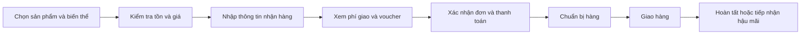
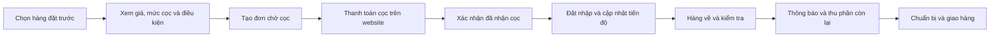
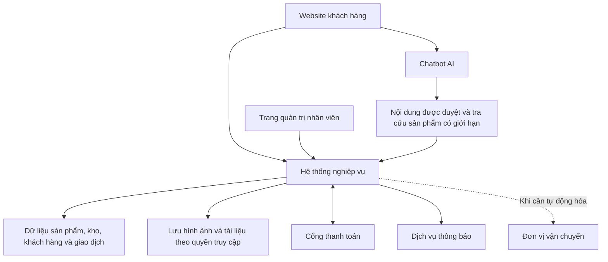

# Tổng quan dự án thương mại điện tử thời trang thương hiệu nhập khẩu

> Tài liệu định hướng sản phẩm và nghiệp vụ, dùng để thống nhất phạm vi với chủ doanh nghiệp và đội ngũ triển khai. Đây chưa phải đặc tả kỹ thuật hoặc chính sách bán hàng đã ban hành.

## 1. Định hướng và mục tiêu

Dự án xây dựng website bán lẻ cho một doanh nghiệp chuyên nhập khẩu và trực tiếp bán giày, dép, quần áo, đồng hồ, túi xách và nước hoa từ các thương hiệu nổi tiếng. Doanh nghiệp quản lý hàng hóa, giá bán, đơn hàng và dịch vụ sau bán; không vận hành sàn cho nhiều nhà bán.

Website phục vụ khách hàng tại Việt Nam, sử dụng tiếng Việt, giá VND và giao hàng trong nước. Hai hình thức bán hàng cùng tồn tại: **hàng có sẵn trong kho** và **hàng đặt trước, khách đặt cọc trực tiếp trên website**.

Định hướng trải nghiệm là giúp khách **tin vào nguồn gốc sản phẩm, chọn đúng mặt hàng và hiểu rõ điều kiện mua**. Website vừa là nơi giới thiệu hàng hóa, vừa là kênh giao dịch và công cụ vận hành cho doanh nghiệp.

| Mục tiêu                   | Giá trị cần đạt                                                                                |
| -------------------------- | ---------------------------------------------------------------------------------------------- |
| Tạo sự tin tưởng           | Thông tin sản phẩm, nguồn gốc, giá và chính sách hậu mãi rõ ràng, có căn cứ                    |
| Giúp khách lựa chọn        | Dễ tìm theo thương hiệu, nhu cầu, ngân sách và thuộc tính; có hướng dẫn chọn và chatbot hỗ trợ |
| Hoàn tất mua hàng          | Khách biết mua gì, cần trả bao nhiêu, khi nào dự kiến nhận hàng và cách theo dõi               |
| Giảm thao tác thủ công     | Nhân viên quản lý tập trung tồn kho, tiền đã nhận, đơn hàng và tiến độ nhập                    |
| Duy trì quan hệ khách hàng | Có lịch sử mua, chăm sóc sau bán; phát triển điểm thưởng ở giai đoạn tiếp theo                 |

Phiên bản mở bán tập trung vào mua hàng, đặt trước, thanh toán, voucher và chatbot AI cơ bản. Tích/đổi điểm được triển khai sau khi luồng bán hàng ổn định.

## 2. Người dùng và trách nhiệm

| Nhóm người dùng                   | Nhu cầu và phạm vi sử dụng                                                                                                        |
| --------------------------------- | --------------------------------------------------------------------------------------------------------------------------------- |
| Khách mua hàng                    | Xem và tìm sản phẩm, chọn biến thể, mua hoặc đặt trước, thanh toán, theo dõi đơn và gửi yêu cầu hỗ trợ                            |
| Nhân viên bán hàng/chăm sóc khách | Tư vấn, theo dõi đơn và yêu cầu hỗ trợ, cập nhật tiến độ nhập, tiếp nhận đổi trả/bảo hành và các cuộc trò chuyện được chuyển tiếp |
| Nhân viên kho                     | Nhập kho, quản lý số lượng từng biến thể, kiểm tra hàng về, chuẩn bị hàng và cập nhật bàn giao vận chuyển                         |
| Chủ doanh nghiệp/quản trị viên    | Quản lý nhân viên và quyền truy cập, giá bán, chương trình khuyến mãi, chính sách, phê duyệt ngoại lệ và xem báo cáo              |

Một người có thể đảm nhiệm nhiều vai trò trong giai đoạn đầu. Quyền sửa giá, điều chỉnh tồn và xử lý hoàn tiền cần được cấp rõ ràng, có lịch sử thao tác để tra cứu.

Khách được xem danh mục và hỏi thông tin sản phẩm mà không cần đăng nhập. Tài khoản khách hàng phục vụ quản lý thông tin nhận hàng, lịch sử mua và quyền lợi sau này; cách xác minh khi tra cứu đơn cần bảo vệ thông tin người nhận.

## 3. Danh mục và mô hình hàng hóa

### 3.1. Sản phẩm và biến thể

Mỗi sản phẩm có thương hiệu, danh mục, tên, hình ảnh, mô tả, hướng dẫn sử dụng/bảo quản và chính sách áp dụng. Các thuộc tính riêng cần phù hợp với từng nhóm hàng, tránh bắt mọi sản phẩm dùng chung một bộ thông tin.

| Nhóm hàng | Thông tin đặc trưng cần hỗ trợ                                                     |
| --------- | ---------------------------------------------------------------------------------- |
| Giày, dép | Size và hệ size, màu, chất liệu, hướng dẫn đo/chọn kích cỡ                         |
| Quần áo   | Size, màu, chất liệu, phom dáng, bảng kích thước                                   |
| Đồng hồ   | Mã mẫu, kích thước mặt, chất liệu, loại bộ máy và thông tin bảo hành được xác nhận |
| Túi xách  | Kích thước, màu, chất liệu, kiểu dáng và phụ kiện đi kèm                           |
| Nước hoa  | Dung tích, nồng độ, nhóm hương, dạng đóng gói và hướng dẫn bảo quản                |

**Biến thể** là lựa chọn cụ thể khách mua, chẳng hạn một đôi giày màu đen size 40 hoặc một chai nước hoa dung tích 100 ml. Giá, mã hàng và số lượng tồn được quản lý ở cấp biến thể khi có khác biệt. Không dùng số lượng chung của sản phẩm để kết luận mọi size/màu đều còn hàng.

### 3.2. Hình thức bán và khả năng cung ứng

- **Hàng có sẵn:** thể hiện số lượng có thể bán từ kho, thời gian xử lý và giao hàng dự kiến.
- **Hàng đặt trước:** thể hiện khả năng nhận đặt, giá đã công bố, mức cọc, số tiền còn phải trả, thời gian giao dự kiến và điều kiện hủy/hoàn.
- **Hàng tạm hết hoặc ngừng nhận đặt:** hiển thị rõ tình trạng; không tự chuyển hàng hết kho thành hàng đặt trước nếu doanh nghiệp chưa mở hình thức này.

Cùng một mẫu có thể có hàng sẵn và hàng đặt trước. Lựa chọn của khách phải được ghi rõ trong đơn để nhân viên biết nguồn cung và lời hẹn giao tương ứng. Chỉ mở nhận cọc khi doanh nghiệp đã kiểm tra khả năng cung ứng và thiết lập điều kiện bán.

### 3.3. Nguồn gốc và cam kết

Website cần có nội dung về doanh nghiệp, quy trình nhập/kiểm tra hàng, tình trạng sản phẩm và chính sách sau bán. Chứng từ hoặc bằng chứng nguồn hàng được lưu phục vụ đối chiếu; phần công khai do doanh nghiệp duyệt, không tự công khai tài liệu nội bộ hoặc thông tin của đối tác.

Phân biệt **thông tin do doanh nghiệp công bố** với **cam kết có bằng chứng xác nhận**. Không mặc định doanh nghiệp là đại lý được thương hiệu ủy quyền; không tự gắn bảo hành chính hãng hay bảo hành quốc tế cho mọi sản phẩm. Chatbot sử dụng cùng nội dung đã được duyệt.

## 4. Phạm vi phiên bản mở bán

| Nhóm chức năng            | Khả năng trong giai đoạn 1                                                                                                 |
| ------------------------- | -------------------------------------------------------------------------------------------------------------------------- |
| Khám phá sản phẩm         | Danh mục, thương hiệu, tìm kiếm theo tên/mã, bộ lọc giá, hình thức bán và thuộc tính theo nhóm hàng                        |
| Chi tiết sản phẩm         | Hình ảnh, thông tin nguồn gốc, biến thể, giá, tình trạng hàng, hướng dẫn chọn/bảo quản, chính sách đổi trả/bảo hành        |
| Giỏ hàng và đặt mua       | Chọn biến thể/số lượng, thông tin người nhận, phí giao hàng, voucher, kiểm tra lại giá và khả năng cung ứng trước xác nhận |
| Hàng đặt trước            | Công bố điều kiện, thu cọc trên website, theo dõi nhập hàng, thông báo hàng về và thu phần còn lại                         |
| Thanh toán                | Theo dõi tiền đã nhận/còn phải thu, lịch sử giao dịch, truy vấn giao dịch chưa rõ kết quả và quản lý hoàn tiền             |
| Tài khoản và theo dõi đơn | Thông tin nhận hàng, lịch sử mua, trạng thái đơn và yêu cầu hỗ trợ; xác minh quyền truy cập thông tin đơn                  |
| Kho và đơn hàng           | Quản lý mã hàng, tồn theo biến thể, nhập/điều chỉnh kho, chuẩn bị hàng và bàn giao vận chuyển                              |
| Voucher                   | Giảm theo số tiền hoặc tỷ lệ, thời hạn, điều kiện áp dụng và giới hạn sử dụng                                              |
| Chăm sóc khách            | Thông báo thay đổi quan trọng, tiếp nhận đổi trả/bảo hành và yêu cầu được chuyển từ chatbot                                |
| Chatbot AI                | Tìm/gợi ý sản phẩm, giải thích thông tin và chính sách, chuyển nhân viên khi cần                                           |
| Quản trị và báo cáo       | Phân quyền, lịch sử thao tác, tổng hợp bán hàng, giao dịch, tiền cọc, số còn phải thu và đơn cần xử lý                     |

Giai đoạn đầu cho phép nhân viên cập nhật tiến độ nhập và mã vận đơn trên trang quản trị. Không yêu cầu tự động kết nối nhà cung cấp hoặc đơn vị vận chuyển để có thể vận hành bản mở bán.

Chưa đưa vào giai đoạn 1: tích/đổi điểm, ứng dụng di động riêng, sàn nhiều nhà bán, thanh toán đa tiền tệ, quản lý nhiều kho và AI tự thực hiện giao dịch.

## 5. Các luồng nghiệp vụ chính

### 5.1. Mua hàng có sẵn

Hệ thống kiểm tra khả năng bán tại thời điểm xác nhận, tránh nhận vượt số lượng khi nhiều khách mua cùng một biến thể. Việc giữ hàng trong lúc chờ thanh toán cần có thời hạn; thời lượng cụ thể sẽ được chốt khi thiết kế chi tiết.

Giá, giảm giá, phí giao và chính sách khách đã chấp nhận được lưu cùng đơn. Việc sửa giá trên danh mục không tự làm thay đổi đơn đã xác nhận.

### 5.2. Đặt trước và đặt cọc trên website

Trước khi thu cọc, khách phải thấy tổng giá trị đơn, khoản cần trả ngay, số còn lại, phí đã biết, khoảng thời gian giao dự kiến và điều kiện hủy/hoàn. Mức cọc có thể cấu hình theo mặt hàng; tài liệu này không ấn định một tỷ lệ chung.

Đơn chỉ được xác nhận **đã nhận cọc** sau khi xác minh kết quả giao dịch. Khi hàng về, nhân viên kiểm tra rồi gửi thông báo để khách thanh toán phần còn lại. Định hướng ban đầu là thu đủ trước khi giao; hạn thanh toán và cách xử lý quá hạn cần được doanh nghiệp ban hành.

Không tự thay thế mẫu, đổi size/màu hoặc tăng giá đơn đã xác nhận. Nếu điều kiện cung ứng thay đổi, nhân viên cần trao đổi và ghi nhận lựa chọn của khách theo chính sách đã công bố.

**Ví dụ minh họa:** với một đơn có tổng phải trả 5.000.000 VND và mức cọc giả định 30%, khách trả 1.500.000 VND trước, còn 3.500.000 VND. Đây chỉ là ví dụ tính toán, không phải chính sách cọc được chốt.

### 5.3. Giỏ hàng có cả hàng sẵn và hàng đặt trước

Đề xuất tách thành đơn hàng có sẵn và đơn đặt trước. Trước khi khách xác nhận, website hiển thị rõ từng nhóm, số tiền cần trả, phí giao và lịch giao dự kiến. Không để khách hiểu rằng mọi sản phẩm sẽ được giao cùng lúc.

Voucher được kiểm tra theo từng đơn đủ điều kiện, không nhân đôi quyền lợi chỉ vì tách đơn. Việc có gộp giao hàng hay không là chính sách vận hành cần xác định trước khi mở bán.

### 5.4. Theo dõi trạng thái riêng

| Khía cạnh  | Nội dung cần theo dõi                                                                                   |
| ---------- | ------------------------------------------------------------------------------------------------------- |
| Đơn hàng   | Chờ xác nhận, đang xử lý, hoàn tất hoặc đã hủy                                                          |
| Thanh toán | Chờ thanh toán, đã nhận cọc, đã trả đủ; các giao dịch hoàn tiền đang xử lý/đã hoàn và số tiền tương ứng |
| Nhập hàng  | Chưa đặt nhập, đã đặt nhập, đang vận chuyển về, đã về kho hoặc gặp sự cố                                |
| Giao hàng  | Chưa chuẩn bị, đang chuẩn bị, đã bàn giao, đang giao, đã giao hoặc giao thất bại                        |
| Hậu mãi    | Tiếp nhận yêu cầu, đang đánh giá và kết quả đổi trả/bảo hành                                            |

Các nhãn trên mô tả nhu cầu nghiệp vụ, chưa phải bộ trạng thái kỹ thuật cuối cùng. **Đã cọc không đồng nghĩa đã trả đủ; đã trả đủ không đồng nghĩa đã giao hàng.**

### 5.5. Xử lý ngoại lệ

| Tình huống                                | Hành vi mong muốn                                                                                               |
| ----------------------------------------- | --------------------------------------------------------------------------------------------------------------- |
| Biến thể hết hàng khi xác nhận            | Dừng đặt mua, thông báo rõ và cho khách điều chỉnh; không âm tồn hoặc tự chuyển sang đặt trước                  |
| Thanh toán thất bại/hết hạn               | Giữ trạng thái chưa thanh toán; cho kiểm tra kết quả hoặc thử lại mà không tạo nghĩa vụ trả trùng               |
| Thông báo giao dịch đến nhiều lần         | Chỉ ghi nhận một lần; không cộng tiền, trừ kho hoặc sử dụng voucher nhiều lần                                   |
| Giao dịch thành công nhưng đơn đã hết hạn | Đưa vào danh sách cần đối soát; kiểm tra khả năng thực hiện hoặc hoàn tiền, không tự giao khi chưa đủ điều kiện |
| Hàng nhập về chậm                         | Cập nhật tiến độ, chủ động thông báo và xử lý lựa chọn của khách theo điều kiện đã công bố                      |
| Không nhập được hàng                      | Dừng nhận thêm đơn bị ảnh hưởng, liên hệ khách và xử lý hoàn khoản đã nhận theo chính sách/cam kết áp dụng      |
| Đổi trả hoặc giao thất bại                | Có người chịu trách nhiệm và lịch sử xử lý; việc nhập lại kho dựa trên hàng thực nhận và kết quả kiểm tra       |

## 6. Thanh toán và voucher

### 6.1. Thanh toán, đối soát và hoàn tiền

Đề xuất bắt đầu với một cổng thanh toán phục vụ thị trường Việt Nam, hỗ trợ khoản thanh toán cho hàng có sẵn, tiền cọc và phần còn lại của đơn đặt trước. Nhà cung cấp cụ thể chưa được chọn; cần xác nhận khả năng tích hợp và điều kiện sử dụng thực tế.

Mỗi giao dịch gắn với đúng đơn và mục đích thu tiền. Trang quản trị thể hiện tổng phải trả, tiền đã nhận, tiền đã hoàn và số còn phải thu. Báo cáo tách khoản cọc của đơn chưa giao khỏi giá trị các đơn đã hoàn tất để chủ doanh nghiệp không nhầm số tiền nhận với kết quả giao hàng.

Hệ thống cần xác minh thông báo từ cổng thanh toán, đối chiếu đơn/số tiền và xử lý thông báo lặp. Tài liệu VNPAY phân biệt địa chỉ thông báo máy chủ (IPN) dùng để cập nhật giao dịch với trang khách được chuyển về để hiển thị kết quả. Đây là nguồn tham khảo cho thiết kế, chưa phải quyết định chọn VNPAY. [Tham khảo kết nối thanh toán VNPAY](https://sandbox.vnpayment.vn/apis/docs/thanh-toan-pay/pay.html).

Giao dịch chưa rõ kết quả cần được đối soát trước khi yêu cầu khách trả lại. Hoàn tiền phải theo dõi đến khi có kết quả, tách biệt với thao tác hủy đơn; VNPAY có tài liệu riêng về truy vấn và yêu cầu hoàn tiền. [Tham khảo QueryDr và Refund](https://sandbox.vnpayment.vn/apis/docs/truy-van-hoan-tien/querydr%26refund.html).

COD hoặc chuyển khoản đối soát thủ công chỉ bổ sung khi doanh nghiệp chốt nhu cầu và quy trình. Website không cần tự lưu thông tin thẻ thanh toán.

### 6.2. Voucher cơ bản

- Hỗ trợ giảm theo số tiền hoặc tỷ lệ; với giảm theo tỷ lệ có thể cấu hình mức giảm tối đa.
- Có thời gian hiệu lực, giá trị đơn tối thiểu, phạm vi sản phẩm/hình thức bán và giới hạn sử dụng.
- Đề xuất mỗi đơn áp dụng một voucher trong phiên bản đầu; hiển thị lý do khi mã không hợp lệ.
- Kiểm tra lại điều kiện khi xác nhận đơn, không chỉ khi khách nhập mã trong giỏ.
- Với đơn đặt trước, ưu đãi được tính một lần trên đơn đủ điều kiện; khoản cọc và khoản trả còn lại không được hưởng lại cùng một ưu đãi.

Quy tắc tính phí giao, cơ sở tính giảm giá và xử lý quyền lợi khi hủy/hoàn cần công bố trước mở bán. Chưa kết hợp điểm thưởng trong giai đoạn 1.

## 7. Chatbot AI hỗ trợ tư vấn

### 7.1. Vai trò và khả năng

Chatbot đóng vai trò trợ lý giúp khách tìm hiểu và lựa chọn, sử dụng danh mục và chính sách do doanh nghiệp quản lý.

| Khả năng              | Ví dụ                                                                                     |
| --------------------- | ----------------------------------------------------------------------------------------- |
| Làm rõ nhu cầu        | Hỏi ngân sách, nhóm hàng, dịp sử dụng hoặc sở thích khi thông tin chưa đủ                 |
| Tìm và gợi ý sản phẩm | Gợi ý túi theo ngân sách hoặc giày có size khách cần, kèm liên kết sản phẩm               |
| Giải thích thuộc tính | Hướng dẫn đọc bảng size, so sánh chất liệu/dung tích từ thông tin đã có                   |
| Giải đáp chính sách   | Giải thích mua hàng sẵn, đặt cọc, giao hàng, đổi trả và bảo hành theo nội dung được duyệt |
| Chuyển nhân viên      | Tiếp nhận yêu cầu xác minh hàng nhập, khiếu nại hoặc trường hợp thiếu dữ liệu             |

### 7.2. Nguồn thông tin và giới hạn

Thông tin mô tả và chính sách lấy từ nội dung được duyệt. Giá, tồn kho, khả năng nhận đặt trước và lịch hàng về lấy từ hệ thống nghiệp vụ tại thời điểm tư vấn. Nếu không lấy được dữ liệu đáng tin cậy, chatbot cần nói rõ chưa xác nhận được và hướng khách đến nhân viên hoặc trang thông tin tương ứng.

Chatbot không tự cam kết tính xác thực của hàng hóa, tư cách đại lý, độ vừa vặn tuyệt đối hay ngày giao chắc chắn khi thiếu căn cứ. Gợi ý size chỉ là hỗ trợ dựa trên bảng đo và thông tin khách cung cấp.

Trong giai đoạn đầu, chatbot không tự sửa đơn, thay đổi giá, tạo voucher, thu tiền hoặc thực hiện hoàn tiền. Thông tin đơn cá nhân chỉ được cung cấp qua luồng tra cứu có xác minh hoặc nhân viên có quyền xử lý.

Yêu cầu chuyển tiếp cần có nơi tiếp nhận và trạng thái xử lý trên trang quản trị. Ngoài giờ phục vụ, khách có thể để lại yêu cầu theo kênh được công bố; không mặc định có nhân viên trực liên tục. Khi dịch vụ AI lỗi, việc xem sản phẩm và mua hàng vẫn hoạt động.

## 8. Vận hành và giải pháp tổng thể

### 8.1. Công việc của doanh nghiệp

Trước khi mở bán, doanh nghiệp cần chuẩn bị dữ liệu sản phẩm, hình ảnh, bảng size, nội dung nguồn gốc, chính sách và đầu mối xử lý từng nghiệp vụ. Với hàng đặt trước, cần có người cập nhật tiến độ và chủ động xử lý các đơn sắp trễ.

Nhân viên kho kiểm tra số lượng và tình trạng khi nhập, chuẩn bị đúng biến thể khi giao, ghi nhận điều chỉnh có lý do. Nhân viên bán hàng theo dõi khoản cọc, phần còn lại, yêu cầu hỗ trợ và các giao dịch cần đối soát. Chủ doanh nghiệp xem danh sách ngoại lệ để quyết định kịp thời.

### 8.2. Các thành phần hệ thống

Website ưu tiên dùng tốt trên điện thoại; nhân viên làm việc qua trang quản trị. Hệ thống nghiệp vụ quản lý các nhóm chức năng: sản phẩm, tồn kho, đơn hàng/đặt trước, thanh toán, khuyến mãi và chăm sóc khách.

Đề xuất khởi đầu bằng một hệ thống nghiệp vụ thống nhất, chia nhóm chức năng rõ ràng để dễ triển khai và vận hành. Dữ liệu giá, kho và giao dịch có một nguồn chính thức; chatbot chỉ được tra cứu thông tin cần thiết, không truy cập trực tiếp tài liệu nhập hàng nội bộ.

Các yêu cầu nền tảng gồm phân quyền, bảo vệ thông tin khách hàng/chứng từ, ghi nhận thao tác quan trọng, sao lưu có khả năng phục hồi và theo dõi lỗi thanh toán/thông báo/AI. Đây là điều kiện phục vụ vận hành thực tế, không phải một giai đoạn tính năng riêng.

Chưa chốt ngôn ngữ lập trình, cơ sở dữ liệu, nhà cung cấp AI, hạ tầng hoặc ngân sách/thời gian. Các quyết định này cần dựa vào đội ngũ, quy mô dự kiến và chi phí vận hành sau khi thống nhất nghiệp vụ.

## 9. Lộ trình phát triển

| Giai đoạn         | Nội dung                                                                                                            | Điều kiện đánh giá                                                                                       |
| ----------------- | ------------------------------------------------------------------------------------------------------------------- | -------------------------------------------------------------------------------------------------------- |
| 1. Mở bán         | Toàn bộ phạm vi tại mục 4; hoàn thiện hai luồng hàng sẵn/đặt trước, thanh toán, voucher, quản trị và chatbot cơ bản | Khách hoàn tất được giao dịch; nhân viên xử lý được đơn, ngoại lệ và đối soát mà không mất dấu tiền/hàng |
| 2. Giữ chân khách | Tích/đổi điểm, danh sách yêu thích, đánh giá sau mua và thông báo hàng về                                           | Luồng bán ổn định, dữ liệu giao dịch đáng tin cậy và có người vận hành chương trình khách hàng           |
| 3. Tối ưu         | Cá nhân hóa gợi ý, tự động hóa vận chuyển, phân tích khuyến mãi; mở rộng nhiều kho khi phát sinh nhu cầu            | Ưu tiên theo số liệu sử dụng, chi phí và vấn đề vận hành thực tế                                         |

**Định hướng điểm thưởng:** cộng điểm cho giao dịch đủ điều kiện đã hoàn tất; điều chỉnh khi hủy/hoàn trả, lưu lịch sử cộng/trừ để giải thích cho khách. Tỷ lệ tích, giá trị đổi, hạn dùng, mức sử dụng tối đa và cách kết hợp voucher sẽ được thiết kế ở giai đoạn 2. Không coi điểm thưởng là ví tiền hoặc tự cam kết khả năng rút tiền.

Không ấn định lịch phát hành khi chưa biết đội ngũ và ngân sách. Mỗi giai đoạn cần có phạm vi và tiêu chí nghiệm thu trước khi triển khai.

## 10. Kiểm tra chất lượng và đo lường

### 10.1. Tình huống cần nghiệm thu khi xây dựng

| Tình huống                                | Kết quả cần kiểm chứng                                                                            |
| ----------------------------------------- | ------------------------------------------------------------------------------------------------- |
| Mua đúng size còn hàng                    | Đơn lưu đúng biến thể, giá, số lượng và người nhận; tồn và thông báo được cập nhật đúng           |
| Nhiều khách mua biến thể cuối cùng        | Không xác nhận vượt khả năng cung ứng; khách không mua được nhận thông báo rõ                     |
| Voucher sai điều kiện                     | Nêu lý do, tính đúng tổng tiền và cho tiếp tục mua theo lựa chọn của khách                        |
| Đặt cọc thành công                        | Thể hiện đúng tiền đã nhận, số còn lại và tiến độ nhập; chưa đánh dấu trả đủ/giao xong            |
| Thanh toán thất bại hoặc thông báo lặp    | Không ghi nhận tiền khi chưa xác minh, không xử lý trùng và có đường đối soát                     |
| Giỏ hàng có hai hình thức bán             | Khách thấy rõ các đơn, phí, số phải trả và thời gian giao trước xác nhận                          |
| Hàng nhập trễ hoặc không nhập được        | Có cập nhật, thông báo, người xử lý và lịch sử giải quyết/hoàn tiền tương ứng                     |
| Hủy đơn hoặc hoàn trả                     | Phân biệt quyết định hủy, hoàn tiền và hàng thực nhập lại kho; không tự kết luận mọi việc đã xong |
| Chatbot thiếu dữ liệu hoặc dịch vụ AI lỗi | Không bịa giá/tồn/lời hẹn; có hướng chuyển tiếp và không chặn luồng mua                           |
| Người không có quyền truy cập             | Không xem được đơn của người khác hoặc sửa thông tin vượt quyền được cấp                          |

Đây là yêu cầu nghiệm thu cho hệ thống tương lai, không phải kết quả kiểm thử của phần mềm hiện có.

### 10.2. Chỉ số vận hành đề xuất

| Chỉ số                  | Cách theo dõi và ý nghĩa                                                                                                                                                                              |
| ----------------------- | ----------------------------------------------------------------------------------------------------------------------------------------------------------------------------------------------------- |
| Tỷ lệ hoàn tất mua hàng | Số phiên thanh toán có ít nhất một đơn nhận đủ khoản ban đầu cần thiết trên tổng phiên bắt đầu thanh toán; mỗi phiên chỉ tính một lần dù tách đơn, phân biệt trả đủ hàng sẵn và cọc đặt trước         |
| Tỷ lệ hủy đơn           | Đơn bị hủy trên tổng đơn đã xác nhận, phân nhóm lý do và hình thức bán                                                                                                                                |
| Tỷ lệ giao đúng hẹn     | Đơn giao không trễ mốc đã hẹn trên số đơn đến hạn giao trong kỳ, kể cả đơn đang trễ chưa giao                                                                                                         |
| Hiệu quả tư vấn AI      | Tỷ lệ cuộc tư vấn gắn với ít nhất một đơn mua trên tổng cuộc tư vấn trong khoảng ghi nhận thống nhất, kèm tỷ lệ chuyển nhân viên; đây là mối liên hệ để theo dõi, chưa chứng minh AI tạo ra giao dịch |
| Tình trạng tiền và hàng | Khoản cọc đang giữ, số còn phải thu, giao dịch chờ đối soát, đơn nhập trễ và biến thể sắp hết                                                                                                         |

Chưa đặt mục tiêu số. Cần thống nhất cách ghi nhận dữ liệu và thu thập số liệu ban đầu trước khi đặt mục tiêu cải thiện.

## 11. Các quyết định cần chốt trước triển khai

| Quyết định                       | Nội dung cần thống nhất                                                                                       | Bên chịu trách nhiệm chính              |
| -------------------------------- | ------------------------------------------------------------------------------------------------------------- | --------------------------------------- |
| Chính sách nguồn gốc và bảo hành | Bằng chứng được phép công bố; phạm vi cam kết của doanh nghiệp và của thương hiệu                             | Chủ doanh nghiệp                        |
| Điều kiện nhận đặt trước         | Khả năng nhận đơn, giới hạn số lượng, giá, tỷ lệ/số tiền cọc và thời gian giao dự kiến theo mặt hàng          | Chủ doanh nghiệp và phụ trách nhập hàng |
| Phần tiền còn lại                | Hạn trả sau thông báo hàng về, cách nhắc và xử lý quá hạn                                                     | Chủ doanh nghiệp                        |
| Hủy/đổi trả/hoàn tiền            | Phân biệt hàng sẵn và đặt trước, điều kiện từng nhóm hàng, hàng giao trễ/không nhập được và chi phí liên quan | Chủ doanh nghiệp và chăm sóc khách      |
| Phí và cách giao hàng            | Biểu phí, khu vực phục vụ, gộp/tách giao, đối tác phù hợp từng loại hàng, kể cả nước hoa                      | Phụ trách vận hành                      |
| Cổng và phương thức thanh toán   | Khả năng thu cọc/trả phần còn lại, đối soát/hoàn, điều kiện sử dụng, chi phí và việc có dùng COD/chuyển khoản | Chủ doanh nghiệp và đội triển khai      |
| Voucher                          | Sản phẩm/đơn đủ điều kiện, cơ sở tính giảm, giới hạn và quyền lợi khi hủy/hoàn                                | Chủ doanh nghiệp                        |
| Chăm sóc khách và AI             | Kênh/giờ tiếp nhận, người xử lý chuyển tiếp, nội dung được duyệt và ngân sách dịch vụ AI                      | Phụ trách chăm sóc khách                |
| Nguồn lực triển khai             | Đội ngũ, ngân sách, quy mô dự kiến, yêu cầu hạ tầng và kế hoạch vận hành sau mở bán                           | Chủ doanh nghiệp và đội triển khai      |

Các mục chưa chốt ở trên là quyết định nghiệp vụ cần hoàn thiện trước khi biến tài liệu này thành đặc tả triển khai. Không dùng ví dụ hoặc đề xuất mặc định trong tài liệu thay cho chính sách doanh nghiệp đã ban hành.

## 12. Tài liệu tham khảo

- [VNPAY — Kết nối cổng thanh toán, IPN và trang trả kết quả](https://sandbox.vnpayment.vn/apis/docs/thanh-toan-pay/pay.html): tham khảo việc xác minh và cập nhật giao dịch.
- [VNPAY — Truy vấn kết quả thanh toán và yêu cầu hoàn tiền](https://sandbox.vnpayment.vn/apis/docs/truy-van-hoan-tien/querydr%26refund.html): tham khảo đối soát và theo dõi hoàn tiền.

Các nguồn này hỗ trợ phần định hướng thanh toán. Việc chọn đối tác và đặc tả tích hợp cần được xác nhận khi triển khai; tài liệu hiện tại không chỉ định nhà cung cấp.
